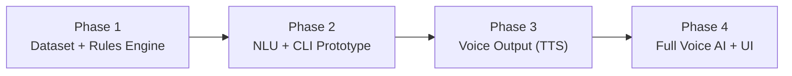

# ROADMAP — Krishi Mitra

> **Milestone**: v1.0 — Hackathon Working Demo
> **Strategy**: 3-Stage Evolutionary Prototyping
> **Core Value**: Every eligibility answer is produced by the deterministic rule engine and can be traced to a written rule — the LLM only listens and speaks, it never decides.
> **Generated from**: `.planning/intel/SYNTHESIS.md` + `.planning/INGEST-CONFLICTS.md`

---

## Conflict Resolutions Applied

Before routing requirements to phases, the following ingest warnings were resolved:

| ID | Warning | Resolution |
|----|---------|------------|
| RESOLVED-W1 | 5-scheme benchmark vs REQ-04's 6-scheme list | **The 5-scheme benchmark set is authoritative.** No rule data exists for Raitha Siri, Krishi Bhagya, Surya Raitha, or KCC. REQ-04 is corrected to name the 5 benchmark schemes. Stale references in `.gsd/REQUIREMENTS.md`, `architecture.md` §2.3/§4, and `voice_interaction_design.md` Script 2 are non-authoritative. |
| RESOLVED-W2 | Competing eligibility rules between `schemes_knowledge_base.md` and `dataset_research.md` | **`schemes_knowledge_base.md` §1 is the canonical rule source.** It is the titled "Scheme Rules Catalog" with official exclusions. `dataset_research.md` §2 is illustrative research output only. Concrete impacts: PMFBY covers Maize and risk types Drought/Excess Rainfall/Pest Attack/Flood/Hailstorm; PM-KISAN has **no** pensioner exclusion; Demo Equipment has **no** max acreage and includes Weeder; Demo Soil includes "Micronutrient Deficient" and has no polyhouse exclusion; Demo Micro-Irrigation is ≤5.0 acres @90% and 5.0–12.5 acres @70%. |
| RESOLVED-W3 | PMFBY ₹15,000/ha payout in demo script | **Never state a payout or compensation amount.** Payout depends on external state; promising one is misinformation for low-literacy farmers. Replies name eligibility and documents only. The `voice_interaction_design.md` Script 1 line is marked non-reusable. |

---

## Must-Haves (from SPEC.md + PROJECT.md)

- [ ] 100% deterministic rule verification — zero LLM-hallucinated eligibility across all 5 benchmark schemes
- [ ] Strict schema modeling of the 5 reference schemes (2 real, 3 synthetic) from `schemes_knowledge_base.md` §1
- [ ] Natural conversational slot extraction in rural Kannada dialects (North Karnataka + Old Mysore)
- [ ] Free/open-source tooling at every tier — no paid APIs, no keys required for Stage 1/2
- [ ] End-to-end voice interaction loop < 2.0 s (design target < 1.8 s)
- [ ] Bimodal feedback: ≤ 25-word spoken reply + synchronous visual scheme cards (ADR-002, locked)

---

## Phases

### Phase 1: Reference Dataset & Deterministic Rule Engine
**Stage**: 1 (Core)
**Status**: ⬜ Not Started
**Objective**: Model the 5 target schemes into structured JSON and build the pure-Python deterministic rule engine with unit test coverage.

**Requirements covered**: DATA-01, DATA-02, ENG-01

**Deliverables**:
| Artifact | Description |
|----------|-------------|
| `data/schemes_dataset.json` | 5 schemes (2 real, 3 synthetic) with eligibility rules, official exclusions, required documents, Kannada metadata, application channels — sourced exclusively from `schemes_knowledge_base.md` §1 (RESOLVED-W2) |
| `backend/rules_engine.py` | Pure-Python deterministic evaluator: `SchemeEvaluator`, `FarmerProfile`, `EvaluationResult` — returns ELIGIBLE / CONDITIONALLY_ELIGIBLE / INELIGIBLE with audit trail, required documents, and application channels. No LLM, no network in the decision path (ADR-001) |
| `backend/test_rules.py` | Unit tests: PM-KISAN positive + 6 exclusion classes; PMFBY crop/season/risk match + Maize inclusion; Demo Micro-Irrigation 90% vs 70% vs rejected (no water source, > 12.5 acres); Demo Equipment with Weeder, no max acreage; Demo Soil with Micronutrient Deficient, no polyhouse exclusion |

**Acceptance criteria**:
- `len(schemes) == 5` with 2 real / 3 synthetic split ✓
- Every synthetic scheme carries `[DEMO / TEST CASE]` marker in its data ✓
- Same profile evaluated twice returns identical JSON ✓
- Full test suite runs offline with no API key ✓
- No `dataset_research.md` rule values appear in the dataset (RESOLVED-W2 check) ✓

**Dependencies**: None — this phase starts from zero.

**Constraints to honor**:
- `schemes_knowledge_base.md` §1 is the **only** rule source (RESOLVED-W2)
- PM-KISAN: no pensioner exclusion; exact 6 exclusion classes from the catalog
- PMFBY: Maize included in notified crops; risk types are Drought, Excess Rainfall, Pest Attack, Flood, Hailstorm
- Demo Equipment: no max acreage; Weeder in equipment list
- Demo Soil: Micronutrient Deficient included; no polyhouse exclusion
- Demo Micro-Irrigation: ≤5.0 acres @90%, 5.0–12.5 acres @70%

---

### Phase 2: Text-to-Text Conversational Prototype (Stage 1 Completion)
**Stage**: 1 (Completion)
**Status**: ⬜ Not Started
**Objective**: Build the Kannada NLU extraction pipeline, multi-turn dialogue manager, and interactive CLI that proves the full text-to-text loop with all guardrails.

**Requirements covered**: NLU-01, NLU-02, NLU-03, CLI-01, PLAT-02

**Deliverables**:
| Artifact | Description |
|----------|-------------|
| `backend/nlu/schemas.py` | `ExtractOut`, `LandSize` Pydantic v2 models with `extra="forbid"`, enum-constrained fields |
| `backend/nlu/prompts.py` | System prompts for extraction and reply phrasing, with dialect examples |
| `backend/nlu/extractor.py` | Extraction orchestrator: sends utterance → receives `ExtractOut` → validates → merges into profile |
| `backend/nlu/normalize.py` | Dialect/jargon normalization: Gunta→acres (×0.025 in Python), Togari→Pigeon Pea, Kushki→Rainfed, etc. |
| `backend/nlu/providers/gemini.py` | Gemini 2.5 Flash provider (`google-genai>=1.0,<2.0`, `temperature=0.1`, `response_schema=ExtractOut`) |
| `backend/nlu/providers/ollama.py` | Ollama `qwen2.5:7b-instruct` fallback provider with JSON mode + post-validation |
| `backend/conversation/state.py` | `ConversationState` Pydantic model, in-process `dict[session_id, ConversationState]`, merge policy (last-write-wins for evidence-backed scalars, set union for crops, `None` never overwrites confirmed) |
| `backend/conversation/dialogue.py` | Dialogue manager: missing-slot detection, proactive Kannada follow-up generation, confirmation of inferred/conflicting values |
| `cli_chat_prototype.py` | Interactive multi-turn CLI: type Kannada → extract → evaluate → print results with audit trail |
| `backend/tests/test_nlu_extraction.py` | NLU extraction tests with dialect and jargon cases |
| `backend/tests/test_conversation_state.py` | State merge policy tests |
| `data/eval/nlu_golden.jsonl` | ≥40 gold examples (10 North Karnataka, 10 Old Mysore, 10 code-mixed, 5 unit traps, 5 multi-turn) |

**Acceptance criteria**:
- Benchmark sentence `ನಮ್ಮ ಹೊಲ ಮೂರ್ ಎಕರೆ, ಬೋರ್ವೆಲ್ ಐತಿ, ಹನಿ ನೀರಾವರಿಗೆ ಸಹಾಯ ಸಿಗ್ತೈತಾ?` returns Demo Micro-Irrigation Support + PM-KISAN eligible (CLI-01) ✓
- "20 ಗುಂಟೆ" evaluates as 0.5 acre; Togari matches PMFBY's Pigeon Pea (NLU-01) ✓
- Message with land size only produces a spoken-Kannada crops question; engine runs only after profile complete (NLU-02) ✓
- All 7 guardrails pass negative tests (NLU-03): eligibility firewall, evidence check, land-unit sanity, conflict quarantine, PII redaction, no payout figures, demo transparency ✓
- `NLU_PROVIDER=gemini|ollama` env var switches providers; Ollama works offline with no API key (PLAT-02) ✓
- No reply states a payout or compensation figure (RESOLVED-W3) ✓

**Dependencies**: Phase 1 complete (rules engine + dataset)

**Constraints to honor**:
- `google-genai>=1.0,<2.0` + `pydantic>=2.6,<3` (SPEC pin, not the `>=0.1.0` floor)
- Land-unit conversion computed in Python, **never** by the model
- `extra="forbid"` on extraction schemas — no derived fields
- Gemini free tier: 15 RPM / 1M TPM — serialize per session, exponential backoff with jitter
- Extraction p95 ≤ 900 ms (Gemini), ≤ 3 s (Ollama)
- Context sent to extractor: current utterance + confirmed profile + unresolved slots only; **never** the scheme catalog

---

### Phase 3: Voice Output Prototype (Stage 2)
**Stage**: 2
**Status**: ⬜ Not Started
**Objective**: Add spoken Kannada voice output to the text prototype using free neural TTS, enforcing brevity and warmth.

**Requirements covered**: TTS-01, TTS-02

**Deliverables**:
| Artifact | Description |
|----------|-------------|
| `backend/tts_service.py` | TTS engine: Edge-TTS (`kn-IN-GaganNeural` / `kn-IN-SapnaNeural`) as default; Sarvam Bulbul as optional upgrade. Fallback to pre-rendered Kannada templates if synthesis fails |
| `backend/tts_formatter.py` | Reply formatter: hard cap 25 words / 2 sentences (design target 15–20 words); rejects and truncates over-long or payout-bearing replies |
| `test_voice_output.py` | Automated tests: generates playable audio, asserts < 500 ms from text-ready to first audio, validates word count and payout-free content |

**Acceptance criteria**:
- Recommendation spoken in natural, warm rural Kannada (TTS-01) ✓
- < 500 ms from text-ready to first audio (TTS-02) ✓
- ≤ 2–3 sentences, hard cap 25 words (ADR-002) ✓
- Over-long or payout-bearing reply rejected by formatter and test fails (TTS-02, RESOLVED-W3) ✓
- Zero API keys required for Edge-TTS path (PLAT-02) ✓

**Dependencies**: Phase 2 complete (CLI prototype with NLU)

**Constraints to honor**:
- Edge-TTS before Sarvam Bulbul (zero API key, zero cost guarantees rehearsable demo)
- Spoken reply is the summary; visual cards carry the detail (ADR-002)
- No payout figures in spoken output (RESOLVED-W3)

---

### Phase 4: Full Voice AI Application & Bimodal UI (Stage 3)
**Stage**: 3
**Status**: ⬜ Not Started
**Objective**: Integrate Kannada ASR, build the bimodal web interface, and close the full voice-in/voice-out loop under 2.0 seconds for hackathon demo.

**Requirements covered**: VOI-01, UI-01, UI-02, APP-01, PLAT-01

**Deliverables**:
| Artifact | Description |
|----------|-------------|
| `backend/asr_service.py` | Kannada ASR: Groq Whisper Large-v3 (free tier) or Sarvam Saaras; streaming, Kannada agricultural prompt conditioning |
| `backend/server.py` | FastAPI unified backend: WebSocket/REST gateway, session manager, orchestrates ASR → NLU → Engine → TTS pipeline |
| `frontend/` | React 18 + Vite + TailwindCSS web app: audio visualizer (pulsing rings via Web Audio API), live Kannada transcript in Kannada script, scheme cards with status colors (Eligible=green, Under Review=yellow, Ineligible=muted), document checklists, `[Real]` vs `[DEMO / TEST CASE]` badges, barge-in (speaking interrupts playback) |
| `frontend/` — reasoning drawer | Auditable reasoning drawer per scheme: exact rules evaluated, criteria matched/failed, gazette reference — matches engine audit trail verbatim |

**Acceptance criteria**:
- Browser voice capture with VAD; 900 ms silence auto-submits; 30 s max utterance; 16 kHz mono (VOI-01) ✓
- Three consecutive spoken turns each under 2.0 s (VOI-01) ✓
- Cards update in the same turn as the spoken reply; speaking over audio stops it (UI-01, barge-in) ✓
- Every card's "why you qualify" points match the engine audit trail verbatim (UI-02) ✓
- Speak → transcribe → evaluate → speak + cards updated in < 2.0 s (APP-01) ✓
- All three stages remain runnable from one checkout (PLAT-01) ✓

**Dependencies**: Phase 3 complete (TTS service)

**Constraints to honor**:
- Voice latency budget: VAD 150 ms + ASR 600 ms + extract+eval 450 ms + TTS first chunk 450 ms + playback 150 ms = ~1.8 s target
- `POST /api/v1/voice/interact` contract from `architecture.md` §4
- Acoustic UX: earcons for listening/processing/confirmed states
- Advisory disclaimer: prototype/decision-support tool, not a government authority
- Frontend: React 18 + Vite + TailwindCSS; Web Audio API for visualizer
- Session state remains in-process (`dict[session_id, ConversationState]`)

---

## Requirement → Phase Traceability

| Requirement | Phase | Description |
|-------------|-------|-------------|
| DATA-01 | Phase 1 | 5 schemes modeled in `data/schemes_dataset.json` |
| DATA-02 | Phase 1 | `[DEMO / TEST CASE]` marker on synthetic schemes |
| ENG-01 | Phase 1 | Pure-Python deterministic evaluator |
| NLU-01 | Phase 2 | Rural Kannada dialect/jargon normalization |
| NLU-02 | Phase 2 | Multi-turn slot filling with proactive follow-ups |
| NLU-03 | Phase 2 | All guardrails (eligibility firewall, PII redaction, etc.) |
| CLI-01 | Phase 2 | Benchmark sentence produces correct eligible set |
| PLAT-02 | Phase 2 | Free tooling — no paid tier, no key for Stage 1/2 |
| TTS-01 | Phase 3 | Natural warm rural Kannada TTS |
| TTS-02 | Phase 3 | < 500 ms, ≤ 2–3 sentences, no payout |
| VOI-01 | Phase 4 | Browser voice capture with VAD + streaming ASR |
| UI-01 | Phase 4 | Bimodal web UI with cards, visualizer, barge-in |
| UI-02 | Phase 4 | Auditable reasoning drawer |
| APP-01 | Phase 4 | Full voice roundtrip < 2.0 s |
| PLAT-01 | Phase 4 | All 3 stages runnable from one checkout |

**Coverage**: 15 / 15 requirements mapped. 0 unmapped. ✓

---

## Phase Dependency Graph

---

## Stale References (tracked, not edited)

These references in source docs are known-stale per INGEST-CONFLICTS.md but are deliberately **not** edited by this roadmap (source docs are read-only during ingest). They should be corrected as follow-ups:

| Source | Stale Reference | Correct Value |
|--------|----------------|---------------|
| `.gsd/REQUIREMENTS.md` REQ-04 | 6 schemes (Raitha Siri, Krishi Bhagya, PM-KISAN, PMFBY, Surya Raitha, KCC) | 5 benchmark schemes (RESOLVED-W1) |
| `architecture.md` §2.3/§4 | `RAITHA_SIRI` in code examples | Remove; not in benchmark set |
| `voice_interaction_design.md` Script 1 | ₹15,000/ha PMFBY payout | Remove payout figure (RESOLVED-W3) |
| `voice_interaction_design.md` Script 2 | Surya Raitha (PM-KUSUM) 60% solar pump | Remove; not in benchmark set |
| `.gsd/STATE.md` | `schemes_db.json`, "Ready for Planning" | `data/schemes_dataset.json`; plans exist |

---

## Decision Log

| Decision | Rationale | Status |
|----------|-----------|--------|
| LLM perceives and phrases; Python engine decides (ADR-001) | Hallucinated eligibility is the core product risk | ✓ Locked |
| ≤ 25-word spoken reply + synchronous visual cards (ADR-002) | Voice alone cannot carry document checklists; latency budget forbids long speech | ✓ Locked |
| 5-scheme benchmark is authoritative (RESOLVED-W1) | No rule data exists for Raitha Siri, Krishi Bhagya, Surya Raitha, KCC | ✓ Locked |
| `schemes_knowledge_base.md` §1 is canonical rule source (RESOLVED-W2) | Titled rule catalog with official exclusions; `dataset_research.md` §2 is illustrative | ✓ Locked |
| Never state a payout amount (RESOLVED-W3) | Amounts depend on external state; over-promising is a Critical eval dimension | ✓ Locked |
| `google-genai>=1.0,<2.0` + Pydantic v2, Ollama fallback | SPEC pin outweighs older floor; schema-constrained output; offline demo safety | ✓ Applied |
| Rule engine path is `backend/rules_engine.py` | 6/7 sources + SPEC-typed plan agree; `schemes_evaluator.py` is prose alias only | ✓ Applied |
| Dataset path is `data/schemes_dataset.json` | All sources except stale STATE.md agree | ✓ Applied |
| NLU as `backend/nlu/` package; CLI as `cli_chat_prototype.py` | 02-AI-SPEC is the higher-precedence technical contract | ✓ Applied |
| Session state in-process (`dict[session_id, ConversationState]`) | DPDP minimisation; no DB for a demo | ✓ Applied |
| Edge-TTS before Sarvam Bulbul | Zero API key, zero cost guarantees rehearsable demo | ✓ Applied |

---

*Roadmap generated: 2026-10-30 from `.planning/intel/SYNTHESIS.md`*
*Source ingest: 15 documents classified, 0 blockers, 3 warnings resolved, 9 auto-resolved*
