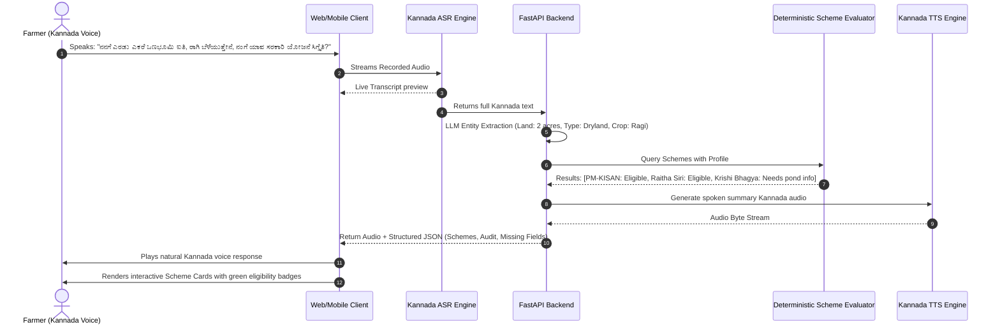

# System Architecture & Technical Specifications — Krishi Mitra

---

## 1. High-Level System Architecture

The architecture decouples **Perception & Natural Language Understanding (AI Layer)** from **Decision Making (Auditable Rule Engine)** to prevent LLM hallucinations while preserving fluid voice conversations.

```mermaid
flowchart TD
    subgraph Client ["Client (Farmer UI / Mobile & Web)"]
        MIC["Audio In (Microphone)"]
        VAD["Client VAD (Voice Activity Detection)"]
        UI_DISPLAY["High-Contrast Visual Feed (Scheme Cards & Audit)"]
        AUDIO_OUT["Audio Player (Synthesized Kannada)"]
    end

    subgraph AudioPipe ["Voice Pipeline (Low Latency)"]
        ASR_ROUTER["ASR Gateway & Pre-processing"]
        ASR_ENGINE["Kannada Speech-to-Text\n(Bhashini / Sarvam AI / Whisper Large v3)"]
        TTS_ENGINE["Kannada Text-to-Speech\n(Sarvam Bulbul / ElevenLabs / Bhashini)"]
    end

    subgraph Backend ["FastAPI Core Backend Engine"]
        API_GW["FastAPI WebSocket / REST Gateway"]
        SLOT_MGR["Session & State Manager\n(Farmer Profile Context)"]
        EXTRACTOR["Entity & Intent Extractor\n(Gemini 2.5 Flash / GPT-4o-mini with Few-shot Kannada)"]
        RULE_ENGINE["Deterministic Scheme Rule Engine\n(Python Auditable Logic)"]
        AUDIT_LOG["Audit & Explanation Generator"]
        SCHEME_DB["Vector & Structured Scheme DB\n(SQLite / JSON Knowledge Base)"]
        PROMPT_ORCH["Dialogue & Audio Response Synthesizer"]
    end

    MIC -->|Opus/WebM Stream| VAD
    VAD -->|Active Voice Audio| ASR_ROUTER
    ASR_ROUTER --> ASR_ENGINE
    ASR_ENGINE -->|Kannada Text + English Loanwords| API_GW
    
    API_GW --> SLOT_MGR
    SLOT_MGR --> EXTRACTOR
    EXTRACTOR -->|Extracted Slots (Crops, Acres, Dist)| SLOT_MGR
    
    SLOT_MGR -->|Complete / Partial Profile| RULE_ENGINE
    SCHEME_DB -->|Scheme Criteria & Rules| RULE_ENGINE
    
    RULE_ENGINE -->|Verified Eligibility Results| AUDIT_LOG
    AUDIT_LOG -->|JSON Decision Tree + Missing Fields| PROMPT_ORCH
    
    PROMPT_ORCH -->|Conversational Spoken Kannada Response| TTS_ENGINE
    PROMPT_ORCH -->|Structured Scheme Cards & Explanations| UI_DISPLAY
    TTS_ENGINE -->|PCM / MP3 Stream| AUDIO_OUT
```

---

## 2. Technology Stack Selection & Hackathon Trade-offs

### 2.1 Speech-to-Text (Kannada ASR)

| Option | Pros | Cons | Recommendation |
| :--- | :--- | :--- | :--- |
| **Sarvam AI (Saaras / Indic Whisper)** | Built specifically for Indian accents, regional dialects, and code-mixed Kannada + English. High accuracy on agri terms. | Cloud API latency ~700ms. | **Primary Recommended** (Best accuracy for hackathon demo). |
| **Bhashini (National Language Translation Mission)** | Free Govt of India initiative, highly reputable for hackathon judges, native Kannada dataset. | Slightly higher setup friction, occasional API throttling. | **Strong Alternative / Hybrid**. |
| **Groq Whisper Large v3** | Extreme speed (<300ms transcription). Free tier available. | Struggles slightly on heavy North Karnataka rural accents without prompt conditioning. | **Fast Fallback / Demo safety net**. |
| **Web Speech API (Browser Native)** | Zero cost, instant, zero server load. | Fails on regional Kannada slang and rural audio noise. | Useful as client fallback. |

> **Hackathon Winning Strategy:** Use **Sarvam AI API** for production-grade Kannada recognition, with **Groq Whisper** conditioned with Kannada agricultural prompt prefixes as high-speed backup.

---

### 2.2 LLM / NLU Layer (Slot Extraction & Dialogue)

* **Recommended:** **Google Gemini 2.5 Flash** or **OpenAI GPT-4o-mini** via fast API.
* **Role:**
  1. Extract structured JSON entities:
     ```json
     {
       "district": "Kalaburagi",
       "land_size_acres": 3.0,
       "crops": ["Pigeon Pea (Togari)", "Jowar"],
       "irrigation_type": "Rainfed",
       "category": "Small/Marginal",
       "intent": "check_scheme_eligibility",
       "query_need": "drought_compensation"
     }
     ```
  2. Normalize localized vocabulary:
     - *"ತೊಗರಿ" (Togari)* $\rightarrow$ Pigeon pea / Red gram
     - *"ಕಬ್ಬು" (Kabbu)* $\rightarrow$ Sugarcane
     - *"ಹೊಲ / ಜಮೀನು" (Hola/Jameenu)* $\rightarrow$ Agricultural land
     - *"ಗುಂಟೆ" (Gunta)* $\rightarrow$ 1/40th Acre
     - *"ಪಹಣಿ / ಆರ್.ಟಿ.ಸಿ" (Pahani/RTC)* $\rightarrow$ Record of Rights, Tenancy and Crops
  3. Formulate empathetic, spoken-form Kannada responses (max 2 concise sentences for voice brevity).

---

### 2.3 Rule Engine (Zero Hallucination Guarantee)

* **Technology:** Pure Python Deterministic Evaluator (`schemes_evaluator.py`).
* **Design Pattern:** Rule Object / Specification Pattern.
* **Mechanism:**
  - Evaluates explicit conditions:
    ```python
    if profile.land_size_acres <= 5.0 and profile.irrigation_type == "Rainfed":
        eligible_schemes.append(RAITHA_SIRI)
        audit_trail.append("Raitha Siri: Eligible. Land < 5 acres and cultivating millets/rainfed.")
    ```
* **Why Judges Love This:** It proves to the jury that the AI cannot hallucinate eligibility, guaranteeing compliance with official government gazette notifications.

---

### 2.4 Text-to-Speech (Kannada TTS)

| Option | Quality | Latency | Pricing / Ease | Recommendation |
| :--- | :--- | :--- | :--- | :--- |
| **Sarvam AI (Bulbul)** | Highly expressive, natural Indian-accented Kannada cadence. | ~400ms | Generous hackathon credits | **Top Recommendation** |
| **ElevenLabs (Multilingual v2)** | Ultra-realistic, emotional, warm elder/expert voice. | ~600ms | Free trial / paid tier | **Best for Final Presentation Wow Factor** |
| **Google Cloud TTS (kn-IN Neural2)** | Standardized, very clear Kannada neural voices. | ~300ms | Free GCP tier | **Solid Alternative** |

---

### 2.5 Frontend & Interface

* **Framework:** **React + Vite + TailwindCSS** (or modern Vanilla JS/HTML5 single-page application with glassmorphic styling).
* **Key UI Components:**
  1. **Dynamic Audio Visualizer:** Pulsing rings with Web Audio API showing the system is actively listening.
  2. **Live Kannada Subtitles:** Real-time speech transcript in Kannada script and transliteration.
  3. **Visual Scheme Accordion Cards:**
     - Status tag: `Eligible` (Green), `Under Review` (Yellow), `Ineligible` (Muted).
     - Benefits highlight (e.g., `₹10,000 Direct Benefit Transfer`).
     - "Why you qualify" audit points.
     - Document checklist with checkboxes (Pahani, Bank Passbook, Aadhaar, Caste Certificate).
  4. **Emergency / Kiosk Action:** "One-click call to Kisan Call Center 1551" or "Locate Nearest Raitha Samparka Kendra (RSK)".

---

## 3. Data Flow Diagram



---

## 4. API Specification Overview

### `POST /api/v1/voice/interact`
* **Input:** Form-data (`audio_file`: WebM/WAV, `session_id`: UUID, `client_state`: Optional JSON).
* **Output:**
```json
{
  "session_id": "9b1deb4d-3b7d-4bad-9bdd-2b0d7b3dcb6d",
  "transcription": "ನಮ್ಮ ಜಮೀನು ಎರಡು ಎಕರೆ, ರಾಗಿ ಬೆಳೆದಿದ್ದೇವೆ.",
  "farmer_profile": {
    "district": "Hassan",
    "land_acres": 2.0,
    "crops": ["Ragi"],
    "irrigation": "Rainfed",
    "farmer_category": "Small Farmer"
  },
  "schemes_evaluated": [
    {
      "scheme_id": "raitha_siri",
      "name_kn": "ರೈತ ಸಿರಿ ಯೋಜನೆ",
      "name_en": "Raitha Siri Scheme",
      "status": "ELIGIBLE",
      "benefit": "₹10,000 per hectare for millet cultivation",
      "audit_reason": "Land size <= 5 acres, cultivating Ragi (minor millet), rainfed land.",
      "documents_required": ["RTC / Pahani", "Aadhaar Card", "Bank Passbook seeded with NPCI"]
    },
    {
      "scheme_id": "pm_kisan",
      "name_kn": "ಪಿಎಂ ಕಿಸಾನ್ ಸಮ್ಮಾನ್ ನಿಧಿ",
      "name_en": "PM-KISAN",
      "status": "ELIGIBLE",
      "benefit": "₹6,000 per year in 3 installments",
      "audit_reason": "Landholding agricultural farmer family with cultivable land.",
      "documents_required": ["Aadhaar", "Land Records (Pahani)", "Bank Account"]
    }
  ],
  "follow_up_question_needed": "ನಿಮ್ಮ ಬ್ಯಾಂಕ್ ಖಾತೆಗೆ ಆಧಾರ್ ಲಿಂಕ್ ಆಗಿದೆಯೇ?",
  "audio_response_url": "/api/v1/audio/stream/resp_492.mp3"
}
```

---

## 5. Authentication, Authorization & Session Security Architecture

Krishi Mitra implements passwordless Phone + OTP authentication with role-based access control and IDOR defense:

```mermaid
flowchart TD
    subgraph FarmerAuth ["Farmer Authentication Flow"]
        REQ["POST /api/auth/request-otp\n(Rate-limited per phone & IP)"] --> SMS["Pluggable SMS Gateway\n(ConsoleProvider in Dev / SMS Gateway in Prod)"]
        SMS --> VER["POST /api/auth/verify-otp\n(Hashed at rest, 5-min expiry, max 5 attempts)"]
        VER --> TOK["Issue Short-lived JWT (15 min)\n+ Rotating Refresh Token in httpOnly Cookie"]
    end

    subgraph TokenLifecycle ["Token Rotation & Family Reuse Detection"]
        REF["POST /api/auth/refresh"] --> CHECK{"Is Refresh Token\nRevoked?"}
        CHECK -->|Yes (Compromise Detected)| REVOKE_ALL["Revoke Entire Token Family\nTerminate All Sessions"]
        CHECK -->|No (Valid)| ROTATE["Revoke Old Token\nIssue New Token (Same Family)\nSet New Cookie"]
    end

    subgraph SecurityPolicy ["Access Control & IDOR Defense"]
        DEP["FastAPI Dependency: get_current_user"]
        RBAC["FastAPI Dependency: require_role('admin')"]
        SESSION_LOCK["Conversation Session Isolation:\nsession['user_id'] == current_user.id\n(Cross-user access denied with 403 Forbidden)"]
    end
```

### 5.1 Security Specifications
1. **Zero Secret Logging**: Neither OTPs, raw tokens, nor raw phone numbers are logged in production mode (`APP_ENV=production`).
2. **In-Memory JWT & httpOnly Refresh Cookie**: Access tokens remain exclusively in client memory (resistant to XSS localStorage theft), while rotating refresh tokens are stored in `httpOnly`, `SameSite=Lax`, `Secure` cookies.
3. **Token Family Reuse Detection**: If an attacker attempts to replay a revoked refresh token, the system detects token theft and immediately revokes all refresh tokens sharing that `family_id`.
4. **Session IDOR Prevention**: Conversation sessions in `/api/chat` and `/api/voice-turn` are strictly bound to the authenticated `user_id`. Attempting to read or write another user's session yields `403 Forbidden`.
5. **Database Persistence**: SQLAlchemy 2.0 with Alembic migrations (`DATABASE_URL`, defaulting to SQLite for local development and PostgreSQL-ready for production).

