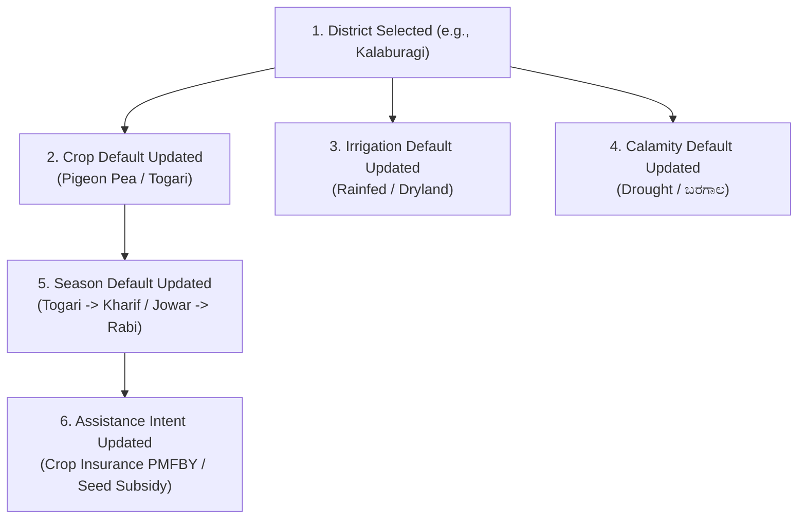

# Karnataka Agriculture, Agro-Climatic Zones & Crop Calendar Research

This document compiles authoritative agricultural domain knowledge from the Department of Agriculture, Government of Karnataka, UAS (University of Agricultural Sciences) Bangalore/Dharwad, and ICAR. It forms the intelligence layer for contextual defaults in Krishi Mitra.

---

## 1. Karnataka's 10 Agro-Climatic Zones

Karnataka is divided into **10 distinct agro-climatic zones**, which dictate soil conditions, average annual rainfall, irrigation dynamics, and dominant cropping patterns:

```
+----+--------------------------------+-------------------------------------+------------------+-------------------------------------------------------------+
| No | Zone Name                      | Key Districts Included              | Avg Rain (mm)    | Dominant Soil & Key Crops                                   |
+----+--------------------------------+-------------------------------------+------------------+-------------------------------------------------------------+
| 1  | North Eastern Transition Zone  | Bidar, North Kalaburagi             | 830 - 890 mm     | Medium black & lateritic. Red Gram (Togari), Jowar, Soybean |
| 2  | North Eastern Dry Zone         | Kalaburagi, Yadgir, Raichur         | 630 - 800 mm     | Deep black clay. Red Gram, Rabi Jowar, Sunflower, Cotton    |
| 3  | Northern Dry Zone              | Vijayapura, Bagalkot, Koppal, Gadag | 520 - 600 mm     | Deep black & saline. Jowar, Bajra, Maize, Cotton, Bengalgram|
| 4  | Central Dry Zone               | Chitradurga, Davanagere, Tumakuru   | 450 - 700 mm     | Red sandy loam. Ragi, Groundnut, Maize, Pomegranate         |
| 5  | Eastern Dry Zone               | Kolar, Chikkaballapura, Bengaluru   | 680 - 890 mm     | Red loamy/gravelly. Ragi, Vegetables (Tomato), Mulberry     |
| 6  | Southern Dry Zone              | Mandya, Mysuru, Chamarajanagar      | 670 - 730 mm     | Red sandy loam/canal. Sugarcane, Paddy, Ragi, Silk          |
| 7  | Southern Transition Zone       | Hassan, Chikkamagaluru, Davanagere  | 610 - 1000 mm    | Red clay loam. Maize, Ragi, Paddy, Potato, Ginger           |
| 8  | Northern Transition Zone       | Dharwad, Belagavi, Haveri           | 750 - 1000 mm    | Black-red transition. Cotton, Soybean, Jowar, Sugarcane, Chilly|
| 9  | Hilly Zone (Malnad)            | Kodagu, Shivamogga, Uttara Kannada  | 1000 - 3100 mm   | Lateritic & forest loam. Paddy, Arecanut, Pepper, Ginger    |
| 10 | Coastal Zone                   | Dakshina Kannada, Udupi             | 3000 - 4500 mm   | Sandy alluvial/laterite. Paddy (Rice), Coconut, Cashew      |
+----+--------------------------------+-------------------------------------+------------------+-------------------------------------------------------------+
```

---

## 2. District-Specific Cropping & Agronomic Intelligence

### 1. Mandya (Cauvery Basin / Southern Dry Zone)
* **Primary Soil:** Red sandy loam with alluvial canal tracts (KRS Dam command area).
* **Top Crops:** **Sugarcane (ಕಬ್ಬು)**, **Paddy (ಭತ್ತ)**, **Ragi (ರಾಗಿ)**.
* **Default Irrigation:** Canal (ಕಾಲುವೆ) / Borewell (ಕೊಳವೆಬಾವಿ).
* **Common Natural Perils:** Fluctuating Cauvery water releases, borewell depletion in non-canal taluks (Nag设定/KR Pet).

### 2. Kalaburagi (Kalyana-Karnataka / NE Dry Zone — "Pulse Bowl of Karnataka")
* **Primary Soil:** Deep black cotton soil (*Kari Mannu*).
* **Top Crops:** **Pigeon Pea / Red Gram (ತೊಗರಿ - Togari)** (GI Tagged), **Rabi Jowar (ಬಿಳಿ ಜೋಳ)**, **Bengal Gram**.
* **Default Irrigation:** **Rainfed / Dryland (ಕುಷ್ಕಿ ಜಮೀನು)** (90%+ rain-dependent).
* **Common Natural Perils:** **Drought (ಬರಗಾಲ)**, dry spells during flowering, wilt disease (*Nanja roga*).

### 3. Dharwad & Belagavi (Northern Transition Zone)
* **Primary Soil:** Medium black transition soils with high fertility.
* **Top Crops:** **Soybean**, **Cotton (ಹತ್ತಿ)**, **Sugarcane (ಕಬ್ಬು)**, **Jowar (ಜೋಳ)**, **Maize (ಮೆಕ್ಕೆಜೋಳ)**.
* **Default Irrigation:** Canal in Belagavi (Ghataprabha/Malaprabha) / Borewell & Rainfed in Dharwad.
* **Common Natural Perils:** Excess rain during harvest, unseasonal showers, pest attack (fall armyworm in maize).

### 4. Kolar & Chikkaballapura (Eastern Dry Zone — Borewell Hub)
* **Primary Soil:** Red gravelly / loamy soil. Severe lack of perennial rivers.
* **Top Crops:** **Vegetables (Tomato - Asia's largest tomato market)**, **Ragi (ರಾಗಿ)**, **Mulberry / Sericulture (ರೇಷ್ಮೆ)**.
* **Default Irrigation:** **Deep Borewell (ಕೊಳವೆಬಾವಿ)** (often 1000+ ft deep) + **Micro-Irrigation (Drip/Sprinkler)**.
* **Common Natural Perils:** Ground water depletion, borewell drying, tomato price crash.

### 5. Hassan (Southern Transition / Malnad Gateway)
* **Primary Soil:** Red sandy clay loam.
* **Top Crops:** **Paddy (ಭತ್ತ)**, **Maize**, **Potato (ಆಲೂಗಡ್ಡೆ)**, **Ragi (ರಾಗಿ)**, **Coffee/Cardamom** (in Sakleshpur belt).
* **Default Irrigation:** Borewell / Rainfed / Hemavathi canal.
* **Common Natural Perils:** Late blight in potato, drought in eastern taluks (Arasikere), unseasonal heavy rain in Sakleshpur.

### 6. Shivamogga (Central Malnad / Tunga-Bhadra Basin)
* **Primary Soil:** Deep red lateritic and alluvial soils.
* **Top Crops:** **Paddy (ಭತ್ತ)**, **Arecanut (ಅಡಿಕೆ)**, **Ginger (ಶುಂಠಿ)**, **Maize**.
* **Default Irrigation:** Canal / Open Well / Perennial stream.
* **Common Natural Perils:** Excessive rainfall, fruit rot (*Kole Roga*) in Arecanut, localized flooding.

---

## 3. Karnataka Sowing Seasons & Crop Calendar

| Season | Local Kannada Name | Calendar Period | Best Suited Crops |
| :--- | :--- | :--- | :--- |
| **Kharif** | **ಮುಂಗಾರು (Mungaaru)** | June – October | Ragi, Pigeon Pea (Togari), Paddy, Cotton, Groundnut, Soybean, Maize |
| **Rabi** | **ಹಿಂಗಾರು (Hingaaru)** | October – March | White Jowar (Bili Jola), Bengal Gram, Sunflower, Wheat, Rabi Paddy |
| **Summer** | **ಬೇಸಿಗೆ (Besige)** | January – May | Groundnut (irrigated), Watermelon, Green Gram, Vegetables |

---

## 4. Contextual Cascading Logic Engine

When a farmer enters information, the system dynamically recalculates defaults for the next question:



### Cascading Rules Matrix:
1. **If District == `Mandya`:**
   - Default Crop $\rightarrow$ **Sugarcane (ಕಬ್ಬು)**
   - Default Irrigation $\rightarrow$ **Canal / ಕಾಲುವೆ**
   - Default Season $\rightarrow$ **Kharif / ಮುಂಗಾರು**
   - Default Need $\rightarrow$ **Micro-irrigation or Power Tiller**
2. **If District == `Kalaburagi`:**
   - Default Crop $\rightarrow$ **Pigeon Pea / ತೊಗರಿ (Togari)**
   - Default Irrigation $\rightarrow$ **Rainfed / ಒಣಭೂಮಿ (ಕುಷ್ಕಿ)**
   - Default Sowing Season $\rightarrow$ **Kharif**
   - Default Peril $\rightarrow$ **Drought / ಬರಗಾಲ**
   - Default Need $\rightarrow$ **PMFBY Crop Insurance / PM-KISAN**
3. **If District == `Kolar`:**
   - Default Crop $\rightarrow$ **Vegetables / Tomato or Ragi**
   - Default Irrigation $\rightarrow$ **Borewell / ಕೊಳವೆಬಾವಿ**
   - Default Need $\rightarrow$ **Drip Irrigation Subsidy (Demo Micro-Irrigation)**
4. **If Crop == `Sugarcane` or `Paddy`:**
   - Irrigation default shifts from Rainfed to **Canal/Borewell**.
5. **If Crop == `White Jowar (Bili Jola)`:**
   - Sowing Season default shifts from Kharif to **Rabi / ಹಿಂಗಾರು**.
