# Step-by-Step Implementation & Hackathon Execution Plan — Krishi Mitra

This roadmap is tailored for a fast-paced 24-36 hour national hackathon. It guides the team from zero to a winning, polished live demo.

---

## 1. Hackathon Phases & Milestones

```mermaid
gantt
    title Hackathon 24-Hour Execution Timeline
    dateFormat HH:mm
    axisFormat %H:%M

    section Phase 1: Setup & Foundations
    Repo Setup, API Keys & Tech Validation :00:00, 02:00
    Rule Engine & Scheme Catalog JSON :01:00, 03:00

    section Phase 2: Core Pipelines
    Kannada Voice Pipeline (ASR + TTS Integration) :03:00, 07:00
    LLM Slot-Filling & State Manager :05:00, 09:00
    Rule Engine & Auditable Logic Integration :08:00, 11:00

    section Phase 3: Frontend & Bimodal UI
    Voice UI (Waveforms, High-Contrast Mic, Kannada Display) :09:00, 14:00
    Scheme Cards, Audit Reasons & Document Checklists :12:00, 16:00

    section Phase 4: Integration & Optimization
    Full End-to-End Latency Tuning (<2s loop) :16:00, 19:00
    Dialect Testing (North Karnataka & Mysore Belts) :18:00, 21:00

    section Phase 5: Pitch Polish & Demo Prep
    Rehearsal with Simulated Farm Scenarios :21:00, 23:00
    Pitch Deck, Video Demo Backup & Architecture Slides :22:00, 24:00
```

---

## 2. Phase-by-Phase Detailed Tasks

### Phase 1: Environment & Knowledge Engineering (Hours 0 - 3)
- [ ] Initialize Git repository with frontend (`/frontend`) and backend (`/backend`).
- [ ] Acquire API credentials:
  - **Sarvam AI API Key** (for Indic Kannada ASR & Bulbul TTS).
  - **Google Gemini API Key / OpenAI API Key** (for fast JSON slot extraction).
  - Optional fallback: **Groq API Key** (Whisper-large-v3).
- [ ] Build `schemes_db.json` containing the 6 major Karnataka schemes (Raitha Siri, Krishi Bhagya, PM-KISAN, PMFBY, Surya Raitha, KCC).
- [ ] Build pure Python `eligibility_engine.py` with deterministic evaluation rules and unit tests.

### Phase 2: Core Backend Engine & Voice Pipeline (Hours 3 - 9)
- [ ] Create FastAPI backend with endpoints:
  - `POST /api/voice/process`: Ingests audio $\rightarrow$ transcribes via ASR $\rightarrow$ extracts slots $\rightarrow$ runs rule engine $\rightarrow$ synthesizes Kannada TTS $\rightarrow$ returns JSON + Audio URL.
  - `POST /api/profile/update`: Handles direct slot edits if the farmer clicks to correct a value.
- [ ] Implement Conversational Memory: Maintains the ongoing conversation context across 3-4 turns to resolve references like *"ಹೌದು, ಎರಡು ಎಕರೆ"* ("Yes, two acres").
- [ ] Formulate few-shot prompt for regional dialect normalization (handling North Karnataka *-aitri*, Mysore *-kanri*, units like *gunta*).

### Phase 3: Bimodal UI & Audio Streaming Frontend (Hours 9 - 15)
- [ ] Create single-page responsive Web App (Vite + React / HTML5).
- [ ] **Voice Interaction Hub:**
  - Giant glowing microphone button with state indications: `Idle` (Green), `Listening` (Orange pulsating waveform), `Thinking` (Blue spinner), `Speaking` (Sound waves).
  - Web Audio API / MediaRecorder recording compressed audio directly.
- [ ] **Real-time Visual Feedback:**
  - Kannada transcript banner showing what the system heard.
  - Interactive "Farmer Profile Pill Badges" (e.g., `Mandya`, `2.5 Acres`, `Ragi`, `Rainfed`) which dynamically light up as the farmer speaks.
- [ ] **Scheme Cards & Audit Visuals:**
  - Large color-coded scheme eligibility cards.
  - "Auditable Reasons" collapsible drawer showing exact policy criteria satisfied.
  - Document checklist with visual badges (RTC/Pahani, Aadhaar, Bank Passbook).

### Phase 4: Hardening & Dialect Testing (Hours 15 - 20)
- [ ] Test the pipeline against 5 realistic rural voice test cases:
  1. *North Karnataka dryland farmer asking for crop loss compensation.*
  2. *Mandya sugarcane/ragi farmer asking about borewell power issues.*
  3. *Small woman farmer asking about PM-Kisan installment delays.*
  4. *Farmer who speaks in fragments over 3 conversational turns.*
  5. *Code-mixed speech ("Borewell fail aagide, drip irrigation ge subsidy ideya?").*
- [ ] Tune audio chunking and latency to maintain < 1.8 seconds roundtrip.

### Phase 5: Pitch Deck, Demo Backup & Presentation (Hours 20 - 24)
- [ ] Record a 60-second seamless offline backup video of the live Kannada conversation (safeguard against venue Wi-Fi / mic issues).
- [ ] Prepare slide deck highlighting:
  1. The Real Problem (why traditional portals fail Indian farmers).
  2. Voice-First vs. Generic Chatbot innovation.
  3. Zero-Hallucination Architecture (Deterministic Rule Engine).
  4. Regional dialect accommodation.
  5. Future Scope (WhatsApp voice note integration, Grama One kiosk deployment).

---

## 3. Team Member Division of Labor (Recommended for 3-4 Person Team)

| Team Member | Primary Responsibility | Key Deliverables |
| :--- | :--- | :--- |
| **Member 1 (Voice & AI Engineer)** | ASR & TTS Pipeline, Dialect Prompts | Sarvam AI integration, latency optimization, conversational slot-filling prompt. |
| **Member 2 (Backend & Logic)** | FastAPI Backend & Rule Engine | `eligibility_engine.py`, scheme catalog, audit trail generator, session state. |
| **Member 3 (Frontend & UX)** | Web Application UI & Audio Visualizer | High-contrast mobile-friendly UI, mic recorder, animated waveforms, scheme cards. |
| **Member 4 (Domain & Pitch)** | Scheme Knowledge Base, Scripts, Demo Prep | Rural dialogue test cases, slide deck, Kannada voice acting for live demo, backup video. |

---

## 4. How to Win the Judges Over (Evaluation Criteria Playbook)

1. **Highlight the "NOTE" in the Problem Statement:**
   - In your first 30 seconds of presentation, point out: *"The problem statement warned against merely putting a microphone on a text chatbot. Here is how our architecture is voice-native from the ground up..."*
2. **Demonstrate Dialect Understanding Live:**
   - Have a team member speak natural North Karnataka or Mysore dialect with agricultural jargon (*Gunta*, *Pahani*, *Kushki*). Watching the system extract "Rainfed land" from "ಕುಷ್ಕಿ ಜಮೀನು" will stun the judges.
3. **Showcase the Auditable Proof:**
   - Show that the assistant does not guess. Click the "Audit Rule" dropdown on the scheme card to reveal the exact government criteria verified.
4. **Demonstrate Multi-Turn Follow-Up:**
   - Show the assistant remembering the farmer's crop and land size when answering follow-up questions like *"ಇದಕ್ಕೆ ಯಾವ ದಾಖಲೆಗಳು ಬೇಕು?"* (*What documents are needed for this?*).
