# Step-by-Step Implementation Plan — Krishi Mitra

This plan implements your evolutionary strategy:
**Stage 1: Text-to-Text Prototype** $\rightarrow$ **Stage 2: Voice Output Prototype** $\rightarrow$ **Stage 3: Full Voice AI Application**.

---

## 1. 3-Stage Development Workflow

```mermaid
flowchart LR
    subgraph S1 ["Stage 1: Text-to-Text Prototype"]
        D1["Model Reference Dataset (5 Schemes)"] --> R1["Python Deterministic Rule Engine"]
        R1 --> N1["Kannada NLU & Slot Filling (Gemini Flash Free)"]
        N1 --> CLI["Interactive Terminal Text CLI"]
    end

    subgraph S2 ["Stage 2: Voice Output Prototype"]
        CLI --> T1["Kannada TTS Service (Edge-TTS / Sarvam Free)"]
        T1 --> T2["Brevity Audio Prompt Synthesizer (<25 words)"]
        T2 --> SCRIPT_AUDIO["Audio Playback Test Harness"]
    end

    subgraph S3 ["Stage 3: Full AI Application"]
        SCRIPT_AUDIO --> A1["Kannada Speech ASR (Groq Whisper / Sarvam)"]
        A1 --> UI["Bimodal Web Interface (React + Waveform + Cards)"]
        UI --> LIVE_DEMO["Sub-2-Second End-to-End Voice AI"]
    end
```

---

## 2. Detailed Task Breakdown

### Stage 1: Text-to-Text Conversational Prototype
- [ ] **Step 1.1: Dataset Structure (`data/schemes_dataset.json`)**
  - Model official PM-KISAN rules and exclusions.
  - Model PMFBY crop, season, and notified area rules.
  - Model Demo Micro-Irrigation Support rules (70-90% subsidy, water source check).
  - Model Demo Agricultural Equipment Assistance rules (farm equipment subsidy caps).
  - Model Demo Soil Improvement Support rules (Soil Health Card deficiencies).
- [ ] **Step 1.2: Deterministic Rule Engine (`backend/rules_engine.py`)**
  - Implement rule evaluator that takes farmer profile JSON and returns eligibility, audit explanations, and document checklist.
  - Write test harness `backend/test_rules.py` covering positive, negative, and exclusion cases.
- [ ] **Step 1.3: Kannada Slot Extractor (`backend/nlu_extractor.py`)**
  - Build prompt template with few-shot examples for North Karnataka and Mysore dialects.
  - Integrate free-tier Gemini 2.5 Flash / local LLM to output structured JSON profile.
- [ ] **Step 1.4: Text CLI Prototype (`cli_chat.py`)**
  - Build interactive terminal chat loop allowing manual testing of multi-turn Kannada dialogue and follow-up slot filling.

---

### Stage 2: Voice Output Prototype (Spoken Kannada Audio Out)
- [ ] **Step 2.1: Free Kannada Neural TTS (`backend/tts_service.py`)**
  - Integrate **Edge-TTS** (`kn-IN-GaganNeural` / `kn-IN-SapnaNeural`) — zero cost, zero API keys required.
  - Add optional Sarvam AI Bulbul integration for expressive rural inflection.
- [ ] **Step 2.2: Audio Dialogue Formatter**
  - Enforce audio brevity: spoken responses strictly under 25 words summarizing top matching benefit.
- [ ] **Step 2.3: Voice Output Verification Script (`test_voice_output.py`)**
  - Feed text queries, verify rule engine, and play back generated Kannada audio file through local speakers.

---

### Stage 3: Full Voice AI Application
- [ ] **Step 3.1: Kannada ASR Streaming Pipeline (`backend/asr_service.py`)**
  - Integrate Sarvam Saaras ASR / Groq Whisper Large v3 (free tier) with Kannada agricultural prompt conditioning.
- [ ] **Step 3.2: FastAPI Unified Backend Server (`backend/server.py`)**
  - WebSocket / REST endpoints serving transcription, slot filling, rule evaluation, and audio streams.
- [ ] **Step 3.3: Bimodal Frontend Application (`frontend/`)**
  - Pulsing microphone with Web Audio visualizer.
  - Live Kannada transcription banner.
  - High-contrast visual scheme cards with `[Real]` vs `[Demo]` badges, green eligibility checkmarks, and document checklists.
- [ ] **Step 3.4: Latency & Dialect Polish**
  - Benchmark and guarantee sub-2-second voice-to-voice turn latency.
  - Prepare rehearsal scenarios and fallback offline recording.
