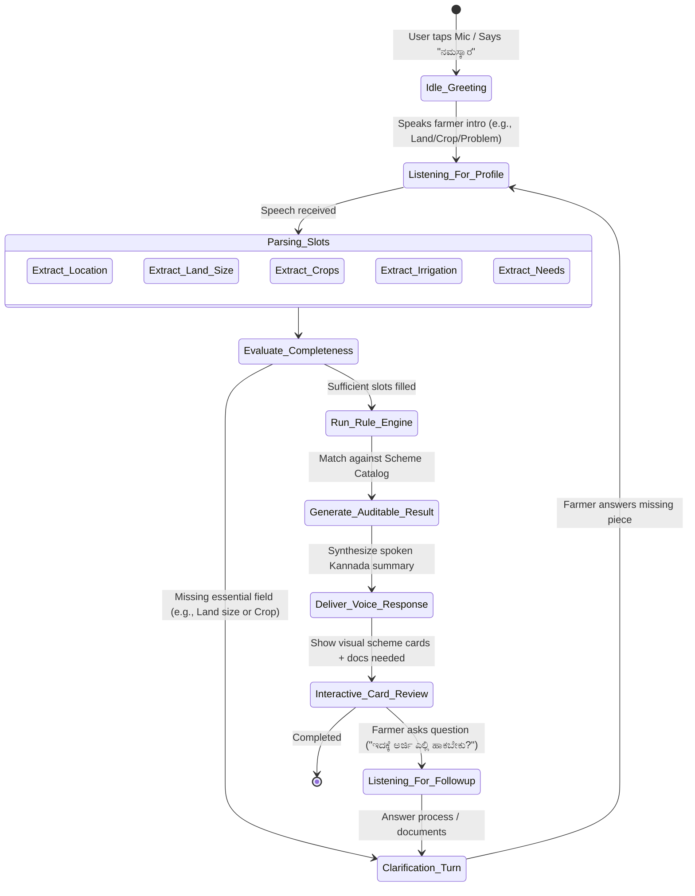

# Voice Interaction Design & Dialogue Flow — Krishi Mitra

> **Hackathon Note:** *"The main innovation should be the quality of the voice interaction—not merely adding a microphone to a generic text chatbot."*

This document outlines the voice-first experience, conversation state machine, acoustic handling, dialect tolerance, and turn-taking latency optimizations.

---

## 1. The Voice-First Paradigm vs. "Mic-on-Chatbot"

| Dimension | Typical Hackathon Flaw (Mic on Chatbot) | Krishi Mitra Voice-Native Experience |
| :--- | :--- | :--- |
| **Response Length** | Dumps 300 words of legalistic policy text on screen and reads it out for 90 seconds. | Spoken responses capped at **2 to 3 concise, rhythmic sentences** (15-20 words max per audio turn). Full details shown visually on cards. |
| **Turn Taking & Interruption** | User must wait for entire robotic audio to finish before clicking mic again. | **Barge-in / Interruptible audio playback**: As soon as farmer speaks, playback pauses immediately via Web VAD. |
| **Vocabulary & Phrasing** | Formal textbook Kannada ("ಕೃಷಿ ಇಲಾಖೆಯ ನಿಯಮಾವಳಿಗಳ ಪ್ರಕಾರ..."). | Warm, natural rural conversational Kannada ("ನಮಸ್ಕಾರ ಅಣ್ಣಾ, ನಿಮ್ಮ ಜಮೀನು ಎಷ್ಟಿದೆ ಹೇಳಿ?"). |
| **Handling Incomplete Inputs** | Throws generic error: *"Missing land size."* | Proactively nudges in follow-up: *"ತೊಗರಿ ಬೆಳೆದಿದ್ದೀರಾ, ಬಹಳ ಒಳ್ಳೆಯದು. ಆದ್ರೆ ನಿಮ್ಮ ಹೊಲ ಎಷ್ಟು ಎಕರೆ ಇದೆ ಹೇಳಿ?"* |
| **Audio Latency** | 6 to 9 seconds (stuck in cloud roundtrips). | **< 1.8 seconds target** using streaming ASR + immediate LLM first-token generation + cached audio cues. |

---

## 2. Conversational State Machine



---

## 3. Natural Dialogue Script Demonstrations (Karnataka Dialects)

### Script 1: North Karnataka Dialect (Kalaburagi / Dharwad Belt)
* **Farmer:** *"ನಮಸ್ಕಾರ್ರೀ, ನಮ್ದು ಅಫ್ಜಲ್ಪುರ್ ಕಡೆ ಹೊಲ ಐತ್ರಿ. ಮೂರ್ ಎಕರೆ ಒಣಭೂಮಿ. ಈ ಸಾರಿ ಮಳಿ ಇಲ್ಲದೆ ತೊಗರಿ ಎಲ್ಲಾ ಒಣಗಿ ಹೋತು. ಸರಕಾರದಿಂದ ಏನಾದ್ರೂ ಪರಿಹಾರ ಸಿಗ್ತೈತೇನ್ರಿ?"*  
  *(Hello sir, our field is near Afzalpur. 3 acres dryland. This time without rain all pigeon pea dried up. Will we get any compensation from government?)*
* **Krishi Mitra (Empathetic Spoken Kannada Voice):**  
  *"ನಮಸ್ಕಾರ ಶರಣಪ್ಪನವರೇ, ಬೆಳೆ ಒಣಗಿ ನಷ್ಟವಾಗಿದ್ದಕ್ಕೆ ಬೇಸರವಿದೆ. ನಿಮ್ಮ 3 ಎಕರೆ ತೊಗರಿಗೆ **ಕರ್ನಾಟಕ ಸಂರಕ್ಷಣೆ ಬೆಳೆ ವಿಮೆ (PMFBY)** ಅಡಿಯಲ್ಲಿ ಹೆಕ್ಟೇರಿಗೆ ₹15,000 ವರೆಗೆ ಪರಿಹಾರ ಪಡೆಯಲು ಅರ್ಹರಿದ್ದೀರಿ. ನಿಮ್ಮ ಪಹಣಿ ಮತ್ತು ಬಿತ್ತನೆ ದೃಢೀಕರಣ ಪತ್ರ ತಕ್ಷಣ ಗ್ರಾಮ ಒನ್ ಕೇಂದ್ರಕ್ಕೆ ಸಲ್ಲಿಸಿ."*  
  *(Hello Sharanappa, sorry to hear about crop loss. For your 3 acres pigeon pea, you qualify for up to ₹15,000/ha compensation under Karnataka Samrakshane PMFBY. Submit your Pahani and Sowing certificate immediately at Grama One center.)*
* **Visual Screen Update:**  
  - Automatically loads PMFBY Scheme Card with Green "Eligible" badge.
  - Lists checklist: `[x] RTC/Pahani`, `[x] Bank Account linked to NPCI`, `[ ] Sowing Certificate`.

---

### Script 2: Southern Karnataka Dialect (Mandya / Hassan)
* **Farmer:** *"ನಾವು ಮಂಡ್ಯದವರು ಕಣ್ರೀ, ಎರಡುವರೆ ಎಕರೆ ತೋಟ ಐತೆ. ಕರೆಂಟು ಸರಿಯಾಗಿ ಬರ್ತಿಲ್ಲ, ಬೋರ್ವೆಲ್ ಓಡ್ಸೋಕೆ ಆಗ್ತಿಲ್ಲ. ಸೋಲಾರ್ ಪಂಪ್ ಏನಾದ್ರೂ ಸಿಗುತ್ತಾ?"*  
  *(We are from Mandya, have 2.5 acres land. Electricity is erratic, unable to run borewell. Can we get any solar pump?)*
* **Krishi Mitra (Spoken Kannada Voice):**  
  *"ಖಂಡಿತ ಗೌಡರೇ, ನಿಮ್ಮ ತೋಟಕ್ಕೆ **ಸೂರ್ಯ ರೈತ (PM-KUSUM)** ಯೋಜನೆಯಡಿ ಶೇಕಡಾ 60 ರಷ್ಟು ಸಬ್ಸಿಡಿಯೊಂದಿಗೆ ಸೋಲಾರ್ ಪಂಪ್ ಸೆಟ್ ಪಡೆಯಲು ನೀವು ಅರ್ಹರಾಗಿದ್ದೀರಿ. ಅರ್ಜಿ ಸಲ್ಲಿಸಲು ನಿಮ್ಮ ಜಮೀನಿನ ಪಹಣಿ ಮತ್ತು ಬೋರ್ವೆಲ್ ವರದಿ ಅಗತ್ಯವಿದೆ."*  
  *(Certainly Gowda-re, for your land you qualify for a 60% subsidized solar pump set under Surya Raitha PM-KUSUM. To apply, your land Pahani and borewell report are required.)*

---

## 4. Acoustic & Voice UX Innovations

1. **Instant Acoustic Earcons:**
   - Soft rising chime when mic starts listening (familiar to rural users).
   - Subtle "processing" sound while audio is transcribing so user knows the assistant is thinking.
   - Low chime when eligibility is confirmed.
2. **Audio Fallback & Retry (Gentle Nudges):**
   - If audio is distorted or background tractor/wind noise is too loud:
     *"ಕ್ಷಮಿಸಿ ಅಣ್ಣಾ, ಗಾಳಿಯ ಸದ್ದು ಜಾಸ್ತಿ ಇದೆ. ನಿಮ್ಮ ಜಮೀನು ಎಷ್ಟು ಎಕರೆ ಅಂತ ಇನ್ನೊಮ್ಮೆ ಸ್ಪಷ್ಟವಾಗಿ ಹೇಳ್ತೀರಾ?"*  
     *(Pardon brother, too much wind noise. Could you please say once again how many acres your land is?)*
3. **Dialect Normalization Prompt Engineering (LLM System Prompt):**
   ```text
   You are 'Krishi Mitra', a compassionate Kannada agricultural officer in Karnataka.
   Input will be rural spoken Kannada transcripts with colloquialisms (-aitri, -nodri, -kanri, gunta).
   1. Extract: district, land_acres, crops, irrigation, assistance_needed.
   2. Always confirm eligibility using only the verified rules passed to you.
   3. Spoken Kannada responses MUST be maximum 25 words, respectful (respectful pronouns: -ರೆ, ನೀವು), and clear.
   ```
4. **Latency Budget Breakdown (< 1800ms):**
   - Client VAD detection: **150ms**
   - Audio transmission & Sarvam ASR: **600ms**
   - Fast LLM Entity Extraction & Rule Evaluation: **450ms**
   - Sarvam/ElevenLabs TTS first audio chunk: **450ms**
   - Browser audio playback initiation: **150ms**
   - **Total:** ~1.8 seconds (feels like a natural human pause).
